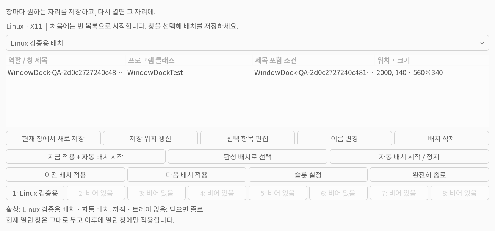
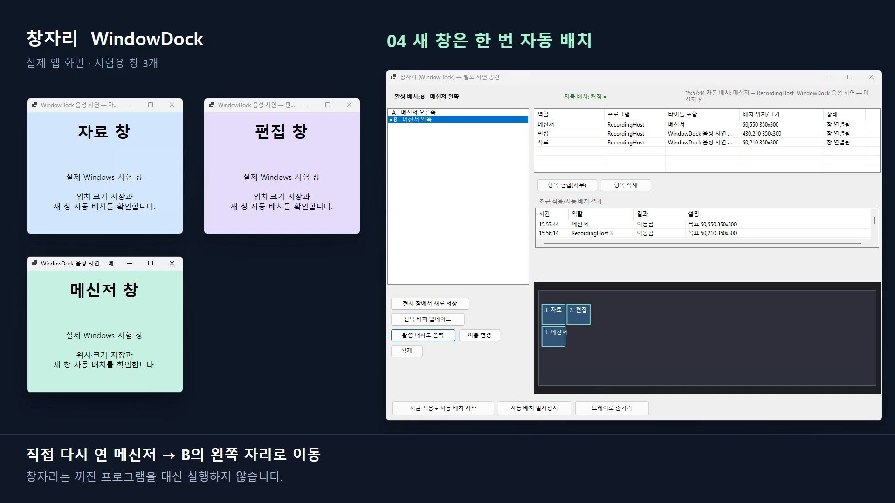
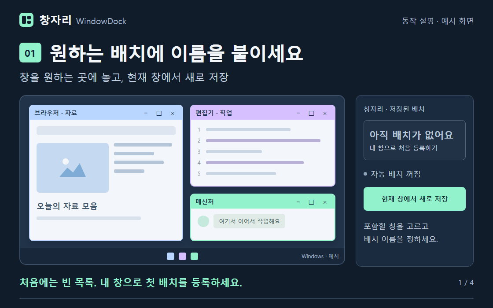
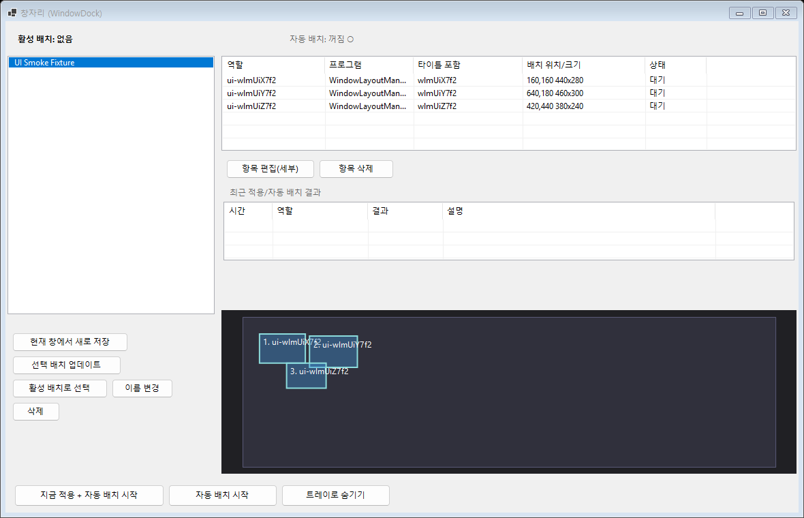
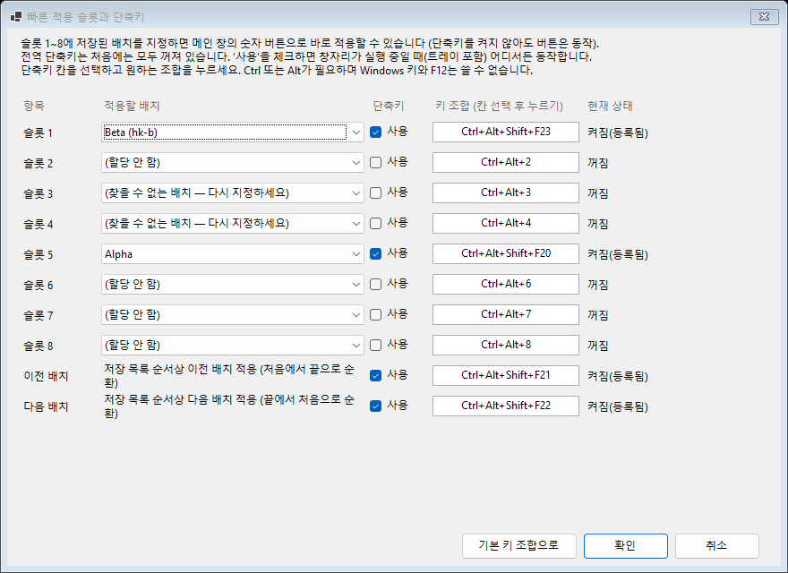

# 창자리 (WindowDock)

**창마다 원하는 자리를 저장하고, 다시 열면 그 자리에.**

여러 프로그램 창의 위치와 크기를 배치별로 저장하는 Windows / Linux 앱입니다. 버튼으로 배치를 전환하고, 이후 새로 열린 창은 저장된 자리에 한 번 자동 배치합니다.

[실행 파일 다운로드](https://github.com/Choi-sungjin/WindowDock/releases/latest) · [사용법](docs/사용법.md) · [검증 범위](docs/검증.md)

## 운영체제별 다운로드 · v0.3.0

| 운영체제 | 다운로드 파일 | 시작 방법 |
| --- | --- | --- |
| Windows x64 | [WindowDock-v0.3.0-win-x64.zip](https://github.com/Choi-sungjin/WindowDock/releases/download/v0.3.0/WindowDock-v0.3.0-win-x64.zip) | 압축 해제 후 `WindowLayoutManager.exe` 실행 |
| Linux x64 · Ubuntu 24.04 X11 | [WindowDock-v0.3.0-linux-x64.tar.gz](https://github.com/Choi-sungjin/WindowDock/releases/download/v0.3.0/WindowDock-v0.3.0-linux-x64.tar.gz) | 압축 해제 후 `./install.sh`, 앱 메뉴에서 창자리 실행 |

**Linux 설치·사용법은 [Linux 안내](docs/Linux.md)를 먼저 보세요.** GTK 3·libwnck 3·시스템 Python이 필요합니다. Wayland와 Linux 전역 단축키는 지원하지 않습니다. Linux는 8개 슬롯 버튼과 이전·다음 버튼으로 배치를 적용하며, 트레이가 없으면 창 닫기로 종료됩니다. 아래 영상·스크린샷과 전역 단축키 설명은 Windows 버전 기준입니다.



*Linux 실제 GTK 화면입니다. 개인 배치는 포함하지 않았습니다. 아래 영상은 Windows 버전입니다.*

**실제 동작 영상 · 수퍼톤 한국어 설명 · 1분 24초**

[](docs/videos/windowdock-real-demo.mp4)

썸네일을 누르면 음성이 포함된 MP4 영상 파일을 열 수 있습니다. 실제 앱 UI와 배치 엔진을 시험용 창 3개로 촬영했습니다. 영상은 v0.1.0의 저장·적용·감시 동작이며, 아래 v0.2.0 단축키 기능은 포함하지 않습니다. [시연 내용과 촬영 범위](docs/실제-동작-영상.md)



*22초 동작 설명 애니메이션입니다. 이해를 돕기 위해 단순화한 예시 화면이며, 실제 UI 녹화나 개인 배치 데이터가 아닙니다. [애니메이션 소스와 재생성 방법](media/windowdock-demo/README.md)*

<details>
<summary>실제 앱 화면 보기</summary>



시험용 창 3개로 확인한 실제 화면입니다. 개인 배치 데이터는 포함하지 않았습니다.

</details>

## Windows 시작하기

처음 사용하는 PC에서는 **빈 배치 목록**으로 시작합니다. 개인 배치는 다운로드에 포함되지 않으므로, 자신의 창을 배치한 다음 직접 등록하세요. 기존 PC에서 업데이트하거나 다시 내려받으면 로컬에 저장한 배치는 유지됩니다.

1. Releases에서 **WindowDock-v0.3.0-win-x64.zip**을 받아 원하는 폴더에 압축을 풉니다.
2. **WindowLayoutManager.exe**를 실행합니다. 설치 프로그램이나 별도의 .NET 런타임은 필요하지 않습니다.
3. 창들을 원하는 위치와 크기로 놓고 **현재 창에서 새로 저장**을 누릅니다.
4. 포함할 창과 배치 이름을 정한 뒤 저장합니다.
5. 배치를 선택하고 **지금 적용 + 자동 배치 시작**을 누릅니다.

**현재 열려 있는 창을 움직이지 않고 감시만 시작하려면**, 저장된 배치를 선택해 **활성 배치로 선택**을 누르고, 자동 배치가 꺼져 있을 때 **자동 배치 시작**을 누르세요.

## 배치 단축키 · v0.2.0

자주 쓰는 배치를 **8개 슬롯**에 지정하고 버튼이나 전역 단축키로 적용할 수 있습니다. **이전 배치 적용 / 다음 배치 적용**은 저장된 목록 전체를 순서대로 순환합니다.

| 동작 | 기본 키 조합 |
| --- | --- |
| 슬롯 1~8 적용 | `Ctrl+Alt+1` ~ `Ctrl+Alt+8` |
| 이전 배치 적용 | `Ctrl+Alt+←` |
| 다음 배치 적용 | `Ctrl+Alt+→` |

단축키 설정에서 배치 지정, 키 변경, 개별 켜기·끄기가 가능합니다. 처음에는 단축키가 모두 꺼져 있고 슬롯도 비어 있습니다. 설정하거나 앱을 시작하는 것만으로 기존 창을 이동하지 않습니다. **적용 버튼 또는 켠 단축키를 누르면 현재 창을 배치하고 자동 감시를 시작합니다.** [자세한 사용법](docs/사용법.md#배치-슬롯과-단축키)



## 어떻게 동작하나요?

| 상황 | 동작 |
| --- | --- |
| 배치 적용 버튼을 누름 | 현재 열려 있고 확실하게 구분되는 창을 저장 위치로 이동 |
| 프로그램이 닫혀 있음 | 실행하지 않고 저장된 자리를 유지 |
| 일치하는 창이 새로 열림 | 자동 배치가 켜져 있으면 한 번 이동 |
| 배치된 창을 직접 옮김 | 수동으로 옮긴 위치와 크기를 유지 |
| 창을 닫음 | 빈자리를 다른 창으로 채우거나 늘리지 않음 |
| 창자리를 다시 실행함 | 기존 창을 이동하지 않고 저장된 활성 배치·감시 상태 복원 |
| 후보 창이 여러 개라 구분할 수 없음 | 임의로 배치하지 않고 결과에 표시 |

같은 프로그램의 여러 창은 **항목 편집(세부) → 타이틀 포함**으로 구분할 수 있습니다. 모니터 해상도·입력·PBP 설정은 변경하지 않습니다.

## 트레이와 로그인 자동 실행

메인 창을 닫으면 트레이에서 계속 실행됩니다. 트레이 아이콘을 두 번 누르면 화면이 열리고, 메뉴에서 배치 적용·자동 배치 일시정지·종료를 할 수 있습니다.

로그인할 때 트레이에서 시작하려면 작업 스케줄러에 실행 파일과 `--start-in-tray` 인수를 등록하세요. [설정 방법](docs/사용법.md#로그인할-때-트레이에서-자동-실행)을 따라 한 번 등록하면 됩니다. ZIP을 내려받아 실행하는 것만으로 자동 시작 항목을 만들지는 않습니다.

## 저장 데이터와 호환성

아래는 Windows 저장 위치입니다. Linux는 `~/.local/share/WindowDock/`(또는 `$XDG_DATA_HOME/WindowDock/`)을 사용하며 두 플랫폼의 개인 배치는 자동으로 공유하지 않습니다.

- 배치: `%APPDATA%\WindowLayoutManager\profiles\`
- 활성 배치와 감시 설정: `%APPDATA%\WindowLayoutManager\settings.json`
- 슬롯과 단축키 설정: `%APPDATA%\WindowLayoutManager\hotkeys.json`
- 기존 **창 배치 매니저**의 데이터를 그대로 사용합니다. 호환성을 위해 실행 파일명과 저장 폴더명은 `WindowLayoutManager`를 유지합니다.
- 사용자 배치, 창 제목, 개인 실행 경로, 계정 설정 및 개발 대화 로그는 이 저장소와 배포 ZIP에 포함하지 않습니다.
- 개인 배치는 각 PC의 위 저장 폴더에만 남습니다. 다른 사용자의 배치를 기본값으로 제공하지 않습니다.

## 소스에서 빌드하기

Linux는 컴파일 없이 `./linux/launch.sh`로 실행하고 `./linux/install.sh`로 설치합니다. 검사·패키징 명령은 [Linux 안내](docs/Linux.md#검증-명령)에 있습니다. 다음은 Windows 빌드 방법입니다.

Windows와 **.NET 10 SDK**가 필요합니다. 외부 NuGet 패키지 없이 Windows Forms와 Win32 API를 사용합니다.

저장소 루트의 PowerShell에서:

```powershell
dotnet build .\src\WindowLayoutManager\WindowLayoutManager.csproj -c Release

dotnet publish .\src\WindowLayoutManager\WindowLayoutManager.csproj -c Release -r win-x64 --self-contained true -p:DebugType=none -p:DebugSymbols=false -p:IncludeSourceRevisionInInformationalVersion=false -o .\artifacts\publish
```

배포할 때는 `artifacts\publish\WindowLayoutManager.exe`와 사용 문서만 새 폴더에 복사하면 됩니다. 사용자 데이터는 실행 파일 옆이 아닌 위의 AppData 경로에 저장됩니다.

### 자체 검사

```powershell
New-Item -ItemType Directory -Force .\artifacts\checks | Out-Null
dotnet .\src\WindowLayoutManager\bin\Release\net10.0-windows\WindowLayoutManager.dll --self-test --output .\artifacts\checks\self-test.json
if ($LASTEXITCODE -ne 0) { throw 'Self-test failed' }
```

추가 GUI·트레이·실제 시험 창 검증 명령과 확인한 한계는 [검증 문서](docs/검증.md)에 정리했습니다.

## 프로젝트 구성

```text
src/WindowLayoutManager/
  App/        한국어 Windows Forms 화면과 트레이
  Services/   배치 저장, 창 매칭, 새 창 감시
  Native/     창 열거·이동 및 Windows API
  Model/      배치·창 정보 모델
  Cli/        명령행 기능과 검사 도구
docs/         사용법과 검증 범위
linux/        Python·GTK·Wnck 기반 Linux X11 앱, 설치기와 검사
scripts/      Linux 배포 파일 생성
.github/      Windows/Linux 빌드 및 자동 검사
media/        README 설명 GIF의 Remotion 소스
```

문제가 있으면 [Issues](https://github.com/Choi-sungjin/WindowDock/issues)에 재현 순서와 기대 동작을 알려주세요. 진단 파일에는 창 제목과 실행 경로가 들어갈 수 있으므로 공유 전에 내용을 확인해 주세요.
